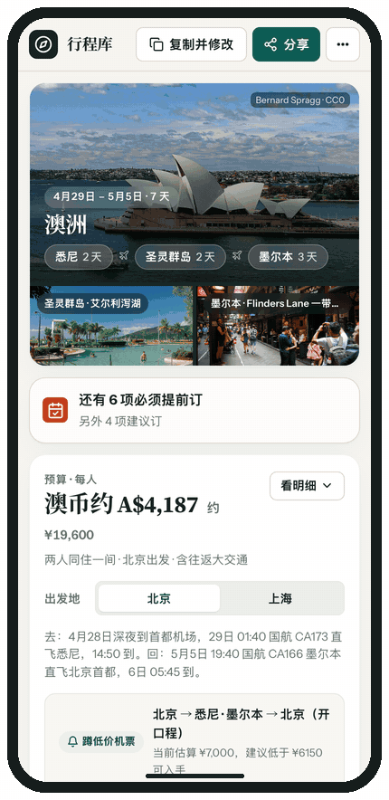

<div align="center">


# static-travel-guide

**把一句模糊的旅行想法，变成能算账、能蹲机票、能看小红书实况、还能拉同伴一起改的在线路书网页。**

[](https://agentskills.io)
[](https://github.com/aladdin0306/static-travel-guide-skill/releases)
[](https://static-travel-guide.huqimeng0306.workers.dev/t/A1JnvRqhFVEg)
[](#核心亮点)
[](LICENSE)

[**在线体验共享样板（可试改）**](https://static-travel-guide.huqimeng0306.workers.dev/t/A1JnvRqhFVEg) · [**手机端实录**](#手机端也能直接打开) · [**快速安装**](#1-安装一次) · [**对话示例**](#2-像聊天一样说想法) · [**自建部署**](worker/README.md) · [**灵感参考站**](https://aladdin0306.github.io/travel-guides/)

<br />


<sub>▲ 真实生成网页实录（图中澳洲仅作展示样板——所有画廊、账本、蹲机票、小红书、天气与协作能力均为通用模板自带，说去哪就生成哪）</sub>

</div>

<br />

## 为什么不用普通 AI 聊天做攻略？

平时让 AI 写旅游攻略，拿到的往往是一长串纯文字：预算要自己按计算器、酒店景点要挨个复制去搜图搜地图、发给同行朋友改两句还会刷屏乱套。

装上 **`static-travel-guide`** 后，AI 不再只吐文字，而是按一套严谨的旅行编辑工作流，直接为你生成并托管一个**真正好用的前端路书网站**：

<p align="center">
   追问7项偏好 -> 自动建站抓图 -> 拿到双权限链接" />
</p>

---

## 核心亮点

<table>
  <tr>
    <td width="50%" valign="top">
      <h3>🧭 先问清楚，再排路线</h3>
      <p>不盲猜你的体力与钱包。排线前自动一次性确认 <b>出发地（支持多城对比）</b>、<b>节奏（休闲游 / 均衡游 / 特种兵）</b>、<b>必去点</b> 与 <b>预算口径</b>，条件对齐后再动手生成。</p>
    </td>
    <td width="50%" valign="top">
      <h3>💰 对账单预算 + 蹲低价机票</h3>
      <p>内置 25+ 全球货币与人民币双栏对账单；支持<b>多出发地一键切换重算总价</b>（如对比北京飞 vs 上海飞），并自动生成 Google Flights <b>免费降价邮件提醒</b>与携程比价直达入口。</p>
    </td>
  </tr>
  <tr>
    <td width="50%" valign="top">
      <h3>📕 小红书实况 + 预约防漏 + 天气穿衣</h3>
      <p>每一站自带<b>小红书近期实况 / 餐厅点单避雷 / 酒店评价</b>一键直达；汇总「必须预约」项目直达官网；按坐标自动拉取<b>当地实时天气或往年同日气温与穿衣建议</b>。</p>
    </td>
    <td width="50%" valign="top">
      <h3>🤝 双权限链接协作 + 送签 PDF 导出</h3>
      <p>自动发布两条云端链接：<b>公开链接</b>发群只读（4G/5G/任意 Wi‑Fi 手机直接打开，支持「复制并修改」克隆副本），<b>私密链接</b>供同伴增删调序、在线自动搜图、回滚最近 10 个历史版本，或彻底删除云端副本；右上角一键导出干净的<b>签证/离线 PDF 路书</b>。</p>
    </td>
  </tr>
</table>

---

## 手机端也能直接打开

生成的公网分享页（`/t/xxx` 与 `/t/xxx/edit#token=...`）托管在云端 HTTPS 上，**手机用 4G/5G 或任意 Wi‑Fi 都能直接打开**，不需要和电脑连同一个 Wi‑Fi。针对手机屏幕做了专门适配：

- **吸顶日期条紧贴顶栏**：下滑看行程时可随时切天，不留缝隙也不遮挡内容
- **三类操作一眼区分**：`谷歌打点`（浅蓝，跳出外部地图导航）、`页内定位`（浅青绿，跳到下方内嵌地图）、`小红书评价/实况/点单`（淡玫红）
- **预算与机票提醒随手看**：支持切换出发地重算预算、查看每日天气与穿衣建议

<div align="center">
  
  <br />
  <sub>▲ 手机端（390px 视口）真实线上页面实录</sub>
</div>

---

## 3 分钟上手

### 1. 安装一次

兼容主流 Agent Skills 标准。挑你正在用的工具复制执行（`--scope user` 代表全局安装，所有项目随时可用）：

**Cursor（编辑器内输入插件命令）**

```text
/add-plugin https://github.com/aladdin0306/static-travel-guide-skill
```

**Cursor（终端命令）**

```bash
gh skill install aladdin0306/static-travel-guide-skill static-travel-guide --agent cursor --scope user
```

**Claude Code**

```bash
gh skill install aladdin0306/static-travel-guide-skill static-travel-guide --agent claude-code --scope user
```

**OpenAI Codex**

```bash
gh skill install aladdin0306/static-travel-guide-skill static-travel-guide --agent codex --scope user
```

**GitHub Copilot**

```bash
gh skill install aladdin0306/static-travel-guide-skill static-travel-guide --agent github-copilot --scope user
```

**Gemini CLI**

```bash
gh skill install aladdin0306/static-travel-guide-skill static-travel-guide --agent gemini-cli --scope user
```

**OpenCode**

```bash
gh skill install aladdin0306/static-travel-guide-skill static-travel-guide --agent opencode --scope user
```

<details>
<summary>更多客户端或仅在当前项目安装？</summary>

把 `--scope user` 改为 `--scope project` 即可仅安装到当前仓库；运行 `gh skill install --help` 可查看完整支持的 30+ 款 Agent 列表。

</details>

---

### 2. 像聊天一样说想法

无需记任何指令格式，直接对 AI 说：

```text
想 2027 年 4 月去京都玩 5 天，两个人，节奏轻松一点，做好把网页发我，我要和朋友一起改。
```

如果约束还不完整，AI 会先向你追问确认（已说过的不会重复问）：

> **AI 追问：** 出发城市（可填多个对比）？休闲游 / 均衡游 / 特种兵？有没有必去景点？预算大约多少（按人还是总计、是否含机票）？具体日期与房间安排？
>
> **你的回答：** 上海或北京出发都行；休闲游；伏见稻荷和清水寺必去；每人 8,000–12,000 元含机票；4 月 10–14 日；两位成人住一间。

---

### 3. 拿到链接，直接使用或拉人共创

AI 复述确认条件后，会自动在后台完成排线、Wikimedia 实景抓图与发布，**不需要你注册任何收费服务器或买域名**，按场景给你最顺手的入口：

- **🏠 你的专属 GitHub Pages 永久链接**（`https://<你的用户名>.github.io/travel-guides/<行程名>/`）：若本机已登录 `gh` CLI，优先直接发布到**你自己的 GitHub 账号下**，国内手机直连快、数据永久归你自己、不依赖作者域名。
- **🌐 协作分享链接**（`https://.../t/xxx` + `/t/xxx/edit#token=...`）：需要发给同行伙伴一起在线改时使用。默认可零配置体验公共沙盒（90 天未编辑自动清理），也可以运行一次 `bash scripts/setup-cloud.sh` 一键部署到**你自己的免费 Cloudflare 账号**。
- **📦 单文件离线 HTML**（`*-offline.html`）：零账号兜底，直接发微信/飞书在手机浏览器打开即可看全部行程、预算与地图打点。
- **💻 本地预览链接**（`http://127.0.0.1:8766/`，可选）：仅作本机调试；日常发给别人或出门用手机打开，请直接使用上面的公网链接或离线 HTML。

---

## 仓库结构与进阶自建

```text
static-travel-guide-skill/
├── skills/static-travel-guide/   # Agent Skill 核心指令、7 项问答规范与字段参考
├── template/                     # 通用前端路书模板（预算账本、地图、天气、小红书、云协作）
├── scripts/                      # 自动建站、Commons 搜图兜底、本地预览与一键云端发布脚本
├── worker/                       # Cloudflare Worker + D1 共享协作与边缘图片加速后端
└── demo/                         # 静态参考样例
```

- **想把云端共享服务部署到你自己的 Cloudflare 账号？** 完全在 Cloudflare 免费额度内（**0 元/月**），直接跑一条命令 `bash scripts/setup-cloud.sh`（按提示浏览器登录一次即可自动建库、部署并记住你的专属域名），或按 [`worker/README.md`](worker/README.md) 手动配置。
- **想看 Skill 底层指令与数据结构？** 详见 [`SKILL.md`](skills/static-travel-guide/SKILL.md) 与 [`reference.md`](skills/static-travel-guide/reference.md)。

---

## 默认云端是免费公共沙盒

内置的 `static-travel-guide.huqimeng0306.workers.dev` 只供试用，不是私人网盘：

- 免登录。知道公开链接的人都能打开，搜索引擎会被 `noindex` 拦住，但链接本身仍然公开。
- 单份行程不超过 100 KB，只保留最近 10 个历史版本。保存和搜图按 IP 限流。
- 不承诺永久保存，也没有 SLA。超过 90 天没有编辑的副本会被清掉，官方样板除外。请不要写入身份证、护照、手机号或机票/酒店预订号。
- 发错了可以用编辑链接里的「彻底删除云端行程」立刻清除正文和历史版本。
- 想长期自己保管，推荐发布到**你自己的 GitHub Pages**（`scripts/publish-gh-pages.sh`），或运行 `bash scripts/setup-cloud.sh` 一键部署到自己的 Cloudflare 免费账号（手动步骤见 [`worker/README.md`](worker/README.md)）。

## 声明与开源协议

- 路书中的票价、汇率、航班班期与往年气温均为估算参考，实际出行前请以航司、酒店及景点官网为准。
- 本项目基于 [MIT License](LICENSE) 开源；自动抓取的实景图片来自 Wikimedia Commons，在页面右下角均保留原作者与 CC 许可署名。
