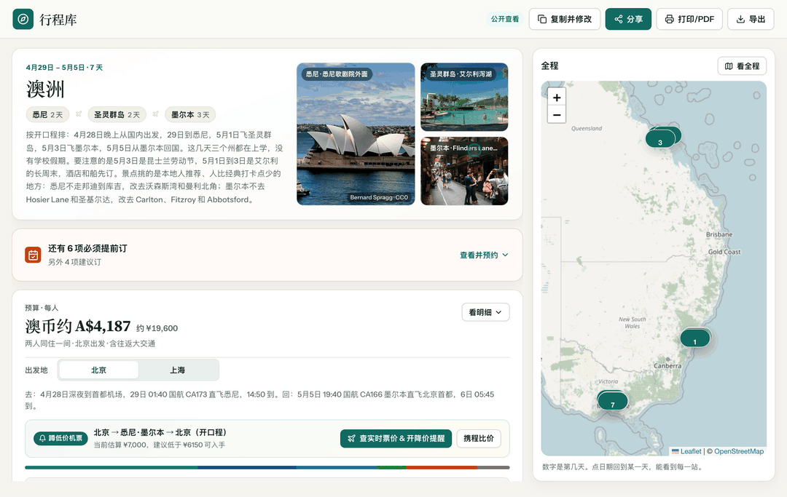

# static-travel-guide

一句话说出你想去哪玩，AI 自动帮你生成一份**手机能看、朋友能一起改**的旅行路书网页。

不用自己复制模板，不用手改 `data.js`，也不用买服务器。你说去哪（日本、欧洲、东南亚、国内……），就生成哪里的完整网页。

- **在线体验样例** — [澳洲 7 天行程页](https://static-travel-guide.huqimeng0306.workers.dev/t/A1JnvRqhFVEg)（点右上角「复制并修改」可直接试改）
- **灵感与参考站** — [个人行程库](https://aladdin0306.github.io/travel-guides/)



---

## 生成的网页有什么？

以上截图里的澳洲页面只是样例，下面所有功能都是**通用模板自带**的：

- **总览与实景画廊** — 自动抓取目的地实景图拼成顶部封面，清晰展示行程天数、城市串联与注意事项。
- **预算账本 & 多出发地对比** — 置顶展示每人预算与分类占比（支持 25+ 币种与人民币换算）；比如拿不准从上海还是北京飞，页面上点一下就能切换对比总价。
- **蹲低价机票** — 自动带入出发地、首尾城市与日期（支持开口程），一键跳去 Google Flights 开启免费降价邮件提醒，或去携程比价。
- **每日时间轴 & 天气穿衣** — 默认展开全部天数，吸顶日期栏可按天筛选；自动拉取当地实时天气或往年同期气温，给出穿衣建议。
- **小红书实况 & 官网订票** — 景点一键搜小红书近期实拍，餐厅搜点单避雷，酒店搜入住评价；必须提前订的项目集中提醒、直达官网，订完可打勾。
- **地图打点 & 导出送签 PDF** — 电脑端联动右侧路线图，手机端一键打开 Google Maps 逐站导航；右上角点「打印/PDF」即可导出干净的签证行程单或离线 PDF。
- **公开分享 & 多人协作** — 自动返回两条云端链接：
  - **公开查看链接**：发群里或给朋友看，只读防误改；别人想拿你的路线改一版自己的，点右上角「复制并修改」就能克隆走。
  - **私密编辑链接**：发给同行伙伴一起改站点、上下调顺序、在线自动搜图换图，改动自动保存，还支持恢复最近 20 个历史版本或重置编辑密钥。

---

## 怎么用（只需 3 步）

### 1. 安装 Skill（装一次即可）

支持所有主流 AI 编程 / 对话工具。下面任选你常用的那一个执行（`--scope user` 表示全局安装，所有项目都能用）：

**Cursor（插件命令）**

```text
/add-plugin https://github.com/aladdin0306/static-travel-guide-skill
```

**Cursor（命令行）**

```bash
gh skill install aladdin0306/static-travel-guide-skill static-travel-guide --agent cursor --scope user
```

**Claude Code**

```bash
gh skill install aladdin0306/static-travel-guide-skill static-travel-guide --agent claude-code --scope user
```

**OpenAI Codex**

```bash
gh skill install aladdin0306/static-travel-guide-skill static-travel-guide --agent codex --scope user
```

**GitHub Copilot**

```bash
gh skill install aladdin0306/static-travel-guide-skill static-travel-guide --agent github-copilot --scope user
```

**Gemini CLI**

```bash
gh skill install aladdin0306/static-travel-guide-skill static-travel-guide --agent gemini-cli --scope user
```

**OpenCode**

```bash
gh skill install aladdin0306/static-travel-guide-skill static-travel-guide --agent opencode --scope user
```

如果只想装在当前目录，把 `--scope user` 改成 `--scope project`；更多支持的客户端可运行 `gh skill install --help` 查看。

---

### 2. 直接说出你的旅行想法

不用管格式，像平时聊天一样告诉 AI：

> 想 2027 年 4 月去京都玩 5 天，两个人，节奏轻松一点，做好把网页发我，我要和朋友一起改。

如果信息还不全，AI 不会瞎编，而是先向你确认几项关键条件：

1. **从哪出发**（可以填多个城市对比，比如“上海或北京”）
2. **去哪里**（国家 / 城市，没想好也可以让它推荐）
3. **什么节奏**（`休闲游` / `均衡游` / `特种兵`）
4. **必去景点**（没有就说没有）
5. **预算范围**（按人还是总计、是否含机票）
6. **出行日期或天数**
7. **同行人数与房间安排**

你简单回复一句：

> 上海或北京出发；去京都；休闲游；伏见稻荷和清水寺必去；每人 8000–12000 含机票；4 月 10–14 日；两大住一间。

AI 复述确认后，就会自动帮你排路线、抓实景图、生成网页并发布上线。

---

### 3. 拿到链接，直接打开或发给同伴

几分钟后 AI 会把链接直接发给你（默认使用内置免费云服务，你不需要注册任何账号）：

- **公开查看链接**：放心发朋友圈、群聊或家人，只读不乱。
- **私密编辑链接**：相当于编辑密码，只发给一起做攻略的同伴（请勿贴到公开网页）。
- **本地预览链接**：电脑浏览器直接打开，同一 Wi‑Fi 下手机也能看，支持 JSON 导入导出备份。

---

## 开发者与自建说明

- **本地运行样例**：
  ```bash
  git clone https://github.com/aladdin0306/static-travel-guide-skill.git
  cd static-travel-guide-skill/demo
  python3 -m http.server 8767 --bind 0.0.0.0
  ```
- **自建免费云端协作服务（0 元/月）**：仓库 `worker/` 目录内置了完整的 Cloudflare Workers + D1 源码，想部署到自己账号可按 [`worker/README.md`](worker/README.md) 操作（5 分钟搞定）。
- **Skill 规范与数据结构**：详见 [`skills/static-travel-guide/SKILL.md`](skills/static-travel-guide/SKILL.md) 与 [`reference.md`](skills/static-travel-guide/reference.md)。

---

## 说明与许可

- 页面中的票价、汇率、航班班期与往年气温仅供参考，出发前请以航司及景点官网为准。
- 代码采用 [MIT License](LICENSE) 开源；景点实景图来自 Wikimedia Commons，按各自原许可署名。
